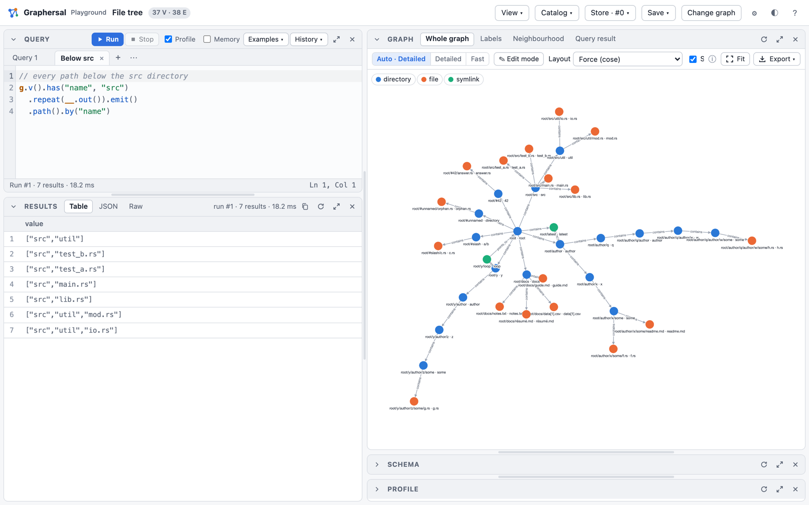

# Graphersal

**An in-memory graph database and traversal engine in Rust, queried with Gremlin.**

[](https://crates.io/crates/graphersal)
[](https://docs.rs/graphersal)
[](https://pypi.org/project/graphersal/)
[](https://github.com/graphersal/graphersal/actions/workflows/ci.yml)
[](LICENSE-APACHE)

**[Playground](https://play.graphersal.dev)** · **[Book](https://graphersal.dev)** ·
**[Step reference](https://graphersal.dev/traversal/step_reference.html)** ·
**[API docs](https://docs.rs/graphersal)**

## Why Graphersal

AI moves faster than the tools around it. We built Graphersal so you don't have to wait for them: a
lightweight, embeddable graph engine you can turn into whatever your AI solution needs — a library
inside your application, a tool for your agents, or a full server with your own features on top.

It works out of the box: a browser UI, an MCP endpoint for AI agents, an AI chat where you simply
ask about your graph in plain language and it writes and runs the queries for you, durable storage
and transactions, and the safety to run queries you did not write — permissions, read-only access,
resource limits and timeouts. You start with a working system, not with a list of components to
wire together.

## A first look

[](https://play.graphersal.dev/#/play?graph=tree&q=%2F%2F%20every%20path%20below%20the%20src%20directory%0Ag.v().has(%22name%22%2C%20%22src%22)%0A%20%20.repeat(__.out()).emit()%0A%20%20.path().by(%22name%22)&run=1)

You ask Graphersal questions in **Gremlin**, the query language of
[Apache TinkerPop&trade;](https://tinkerpop.apache.org): start somewhere in a graph, walk along its
edges, filter, group and count.

```groovy
// who created software together with marko?
g.v().has("name", "marko").as("me")
  .out("created").in("created")
  .where(P.neq("me"))
  .path().by("name")
```

[Run it in the playground](https://play.graphersal.dev/#/play?graph=modern&q=%2F%2F%20who%20created%20software%20together%20with%20marko%3F%0Ag.v().has(%22name%22%2C%20%22marko%22).as(%22me%22)%0A%20%20.out(%22created%22).in(%22created%22)%0A%20%20.where(P.neq(%22me%22))%0A%20%20.path().by(%22name%22)&run=1):
the real engine, compiled to WebAssembly, runs in your browser. Nothing to install, and your data
never leaves your browser.

## What you get

- **Gremlin, two ways.** Build traversals in Rust or write them as text in the Gremlin DSL, in
  snake_case or in Gremlin's own camelCase (`has_label` or `hasLabel`). The same text runs in the
  browser, on the command line, from Python and through an AI agent.
- **A playground in the browser.** Write a query and see a table, the graph drawing, the schema and
  the optimized plan.
- **A command line tool.** One-shot queries for shell scripts, an interactive REPL with completion
  and help, and a local server that brings the playground UI to a graph on your disk.
- **AI agents on your graph.** The server speaks the Model Context Protocol (MCP), so Claude Code or
  another MCP client can query the graph you are looking at. In the playground's AI Chat tab you ask
  about your graph in plain language, and the model of your choice writes and runs the queries
  (experimental).
- **Safe by construction.** Every traversal is atomic: it commits completely or leaves nothing
  behind. Schemas (a subset of JSON Schema) are enforced on write. Limits, timeouts and permissions
  make it safe to run queries you did not write.
- **Durable when you need it.** A graph lives in memory, and the Store keeps it on disk: every
  commit goes to a write-ahead log, and you can go back to any point in time, fork, roll back, back
  up and repair. The file format is a public specification.
- **Fast and observable.** A rule-based optimizer rewrites each query; `profile()` shows the
  optimized plan with timings, traverser counts and memory per step.
- **Open for integration.** Rust and Python APIs, saved (named, parameterized) queries stored in the
  graph, change capture with commit hooks, GraphSON 3.0 and GraphML files, and a storage trait to
  run the whole engine on a storage of your own.

## Get started

### In the browser

Open **[play.graphersal.dev](https://play.graphersal.dev)**, pick a sample graph and press Run. The
[playground tour](https://graphersal.dev/getting_started/playground_tour.html) shows every panel.

### On the command line

```bash
cargo install graphersal-cli          # the binary is `graphersal`

graphersal -e 'g.v().has("name", "marko").out("knows").values("name")'
graphersal --graph people.json -e 'g.v().has_label("person").count()'    # GraphSON or GraphML
graphersal                                                               # interactive REPL
graphersal --graph people.json --server --mcp      # the playground UI + MCP on http://127.0.0.1:8080
```

The result goes to stdout, a diagnostic to stderr, and a failing query exits with `1`, so a shell
script or a CI job can check a graph. See [The Command Line](https://graphersal.dev/getting_started/cli.html)
and [Dev Server, MCP and AI Chat](https://graphersal.dev/getting_started/server_mcp_ai.html).

### From Rust

```toml
[dependencies]
graphersal = { version = "0.1", features = ["script", "io", "display"] }
```

```rust
use graphersal::prelude::*;

let graph = GraphSource::tinkerpop_modern();
let friends = graph
    .read()
    .traversal()
    .v(None)
    .has("name", "marko")
    .out("knows")
    .values("name")
    .to_list()?; // ["josh", "vadas"]

// the same query as Gremlin text (feature `script`)
let names = graphersal::script::eval_value(
    std::sync::Arc::new(graph),
    r#"g.V().has("name", "marko").out("knows").values("name").toList()"#,
)?;
```

Every feature is off by default: `script` (the Gremlin DSL), `io` (GraphSON and GraphML),
`display` (tables), `serde`, `persist` (snapshots, journal and the Store). See the
[Rust Quick Start](https://graphersal.dev/library/rust.html).

### From Python

```bash
pip install graphersal
```

```python
import graphersal

graph = graphersal.Graph.tinkerpop_modern()
graph.query('g.V().has("name", "marko").out("knows").values("name")')
# ['josh', 'vadas']
```

See the [Python Quick Start](https://graphersal.dev/library/python.html).

## How mature is it

Graphersal 0.1 is a first public release, built with the care of a database:

- **TinkerPop conformance.** Apache TinkerPop's own Gherkin test suite (3.8.2) runs on every test
  run. More than 95 % of the scenarios in scope pass, and no implemented step gives a wrong result.
  The rest are steps that are not implemented yet or differ on purpose; each difference is
  documented ([compliance](https://graphersal.dev/for_developers/tinkerpop_compliance.html),
  [deviations](https://graphersal.dev/for_developers/tinkerpop_deviations.html)).
- **Tested hard.** About 90 % line coverage; randomized differential tests and fuzzing of queries,
  file decoders, checkpoints and backups run in every `cargo test`, with long budgets before each
  release. A query that goes wrong ends in an error with a `help()` text, never in a crash.
- **A public storage format.** Snapshots, the write-ahead log and the Store are described byte by
  byte in the [format specification](https://graphersal.dev/persistence/format.html); every
  decoder treats its input as hostile.
- **Clear stability labels.** Within 0.1.x the public API of `graphersal` (outside the items
  marked experimental), the DSL and the schema format change only additively. The storage traits
  (`GraphStorage`, `PersistentStorage`, `StoreDir`) are experimental in 0.1.x, and the dev
  server's HTTP API is internal.

Graphersal is **not a complete copy of TinkerPop.** Read
[Graphersal and TinkerPop](https://graphersal.dev/concepts/graphersal_and_tinkerpop.html) for what
is the same, what is different and why.

## Repository

| Path | What |
|---|---|
| [`crates/graphersal`](crates/graphersal) | the library: storage, traversal engine, optimizer, Gremlin DSL, schema, persistence |
| [`crates/graphersal-cli`](crates/graphersal-cli) | the `graphersal` binary: one-shot runner, REPL, dev server with MCP, `graphersal store` |
| [`bindings/py-graphersal`](bindings/py-graphersal) | the Python package `graphersal` |
| [`playground`](playground) | the browser playground (runs `crates/graphersal-wasm`) |
| [`crates/graphersal-storage-tests`](crates/graphersal-storage-tests) | the conformance suite for your own `GraphStorage` |
| [`book`](book) | the documentation at [graphersal.dev](https://graphersal.dev) |
| [`roadmap`](roadmap) | plans and designs |

Building from source needs Rust 1.88 or newer:

```bash
cargo build --release -p graphersal-cli      # target/release/graphersal
```

## Contributing

Bug reports, questions and pull requests are welcome. Contributions are accepted under the
Apache-2.0 licence with a DCO sign-off (`git commit -s`); see [CONTRIBUTING.md](CONTRIBUTING.md).
Please report security issues privately as described in [SECURITY.md](SECURITY.md).

## License

Licensed under the [Apache License, Version 2.0](LICENSE-APACHE); see also [NOTICE](NOTICE). Use of
the project name is described in [TRADEMARKS.md](TRADEMARKS.md).

Graphersal is compatible with, and inspired by, Apache TinkerPop Gremlin. It is an independent
project: it is not part of Apache TinkerPop and is not endorsed by the Apache Software Foundation.
Apache TinkerPop, TinkerPop and Gremlin are trademarks of the Apache Software Foundation.
