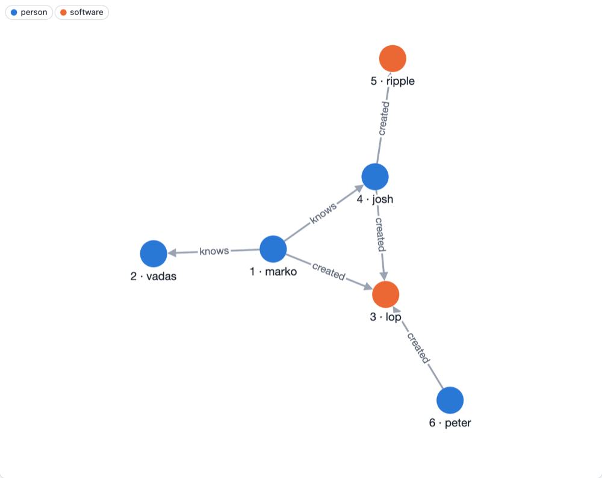

# The Property Graph Model

Graphersal stores a **property graph**, the model of Apache TinkerPop and most graph databases.



This is the "modern" sample graph that ships with TinkerPop and with Graphersal (`--graph modern`,
`GraphSource::tinkerpop_modern()`). It has the four building blocks of the model:

- **Vertices** are the things: here four people and two pieces of software. Every vertex has an
  **id** (`"1"` is marko).
- **Edges** are the connections. An edge has a direction, from its *out* vertex to its *in* vertex:
  marko *knows* josh, josh *created* ripple. An edge has an id too.
- **Labels** say what kind of thing a vertex or an edge is: `person`, `software`, `knows`,
  `created`. Queries usually start by label.
- **Properties** are key-value pairs on vertices and on edges: a person has a `name` and an `age`,
  a piece of software a `name` and a `lang`, an edge a `weight`.

```text
$ graphersal -e 'g.v("1").element_map()'
╭─────┬────┬────────┬───────╮
│ age │ id │ label  │ name  │
├─────┼────┼────────┼───────┤
│ 29  │ 1  │ person │ marko │
╰─────┴────┴────────┴───────╯
```

## Values

A property value is a string, a 64-bit integer, a 64-bit float, a boolean, `null`, a UUID, an
array or an object (a nested map). Arrays and objects can be nested, and steps reach inside them
with path keys such as `jpath("address.city")` ([Path Keys](../users_guide/jpath_keys.md)).
Values keep their type: a string that looks like a number or a date stays a string unless a
schema declares otherwise. Dates and times come in a later release.

## Graphersal additions

- A vertex can carry **several labels** (`person` and `employee`); the first one is its primary
  label, which `label()` returns as TinkerPop does
  ([Multi-Label Vertices](../users_guide/multi_label_vertices.md)).
- A graph can have a **schema**: the labels, their properties and types, and which edges may
  connect which labels, enforced on every write ([Schemas](../users_guide/schema_enforcement.md)).
- A graph keeps a **catalog** of named definitions next to the data, such as saved queries
  ([Saved Queries](../users_guide/saved_queries.md)).

## No database server

A Graphersal graph lives in the memory of the process that uses it: your Rust program, the Python
interpreter, the browser tab or the `graphersal` command line tool. There is no separate database
server to run. When the graph must survive the process, the Store keeps it on disk
([Persistence Overview](../persistence/overview.md)).
