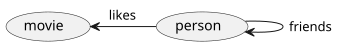

# Why a Graph?

Many questions are about **connections**: who knows whom, what depends on what, which path leads
from here to there. A graph stores the connections themselves, so such a question is answered by
walking along them instead of reconstructing them.

## Questions a graph answers well

- **Networks of people and things.** Friends of friends, colleagues who worked on the same
  project, customers who bought what similar customers bought.
- **Dependencies and impact.** Which services break when this database goes down? Which packages
  pull in this library, directly or through ten others? Which documents cite this one?
- **Infrastructure and inventory.** Servers, networks, accounts and owners, and how they are wired
  together: "which public endpoints can reach this host?".
- **Hierarchies and trees.** Directories, organisational charts, bills of materials: every part
  below this one, at any depth.
- **Paths.** The shortest or every route between two things; cycles that should not exist.
- **Knowledge.** Facts as connected entities, the context an AI agent retrieves before answering
  (the graph behind "GraphRAG").

## Connections as data

Take a small social graph: people are friends with people and like movies.



*Which people have a friend of a friend who likes "Terminator"?* In Gremlin the question reads
like a walk through the picture:

```rhai
g.v().has_label("person").as("person")   // start at every person, remember it
  .repeat(__.out("friends")).times(2)    // follow "friends" twice
  .out("likes").has("title", "Terminator")
  .select("person")                      // back to the person we started from
  .dedup()
  .values("name")
```

In a relational database the same question needs a self-join of the friendship table for every
hop, and the number of hops is fixed in the SQL text:

```sql
SELECT DISTINCT p.name
FROM person p
JOIN friends f1 ON f1.from_id = p.id
JOIN friends f2 ON f2.from_id = f1.to_id
JOIN likes   l  ON l.person_id = f2.to_id
JOIN movie   m  ON m.id = l.movie_id
WHERE m.title = 'Terminator';
```

"Up to five hops" or "any depth" makes the SQL much harder (recursive common table expressions),
while the traversal only changes `times(2)` into `times(5)` or into an `until(...)` condition.

## Why it is fast

A graph engine keeps, with every vertex, the list of its edges. Following an edge is a direct step
to the neighbour, not a lookup in an index of the whole table, so the cost of a traversal grows
with the part of the graph it actually touches, not with the size of the data set. That is why
deep or recursive questions stay cheap on a graph and become expensive as joins.

The reverse holds too: a graph is not the best tool for everything. Aggregations over millions of
rows of the same shape ("total revenue per month") are what relational and columnar databases are
built for. Graphersal is an in-memory engine, so a graph has to fit into memory; see
[Current Limitations](../users_guide/current_limitations.md).

## Next

[The Property Graph Model](property_graph.md) introduces vertices, edges, labels and properties,
and [Gremlin in Ten Minutes](gremlin_tour.md) the steps of a traversal.
