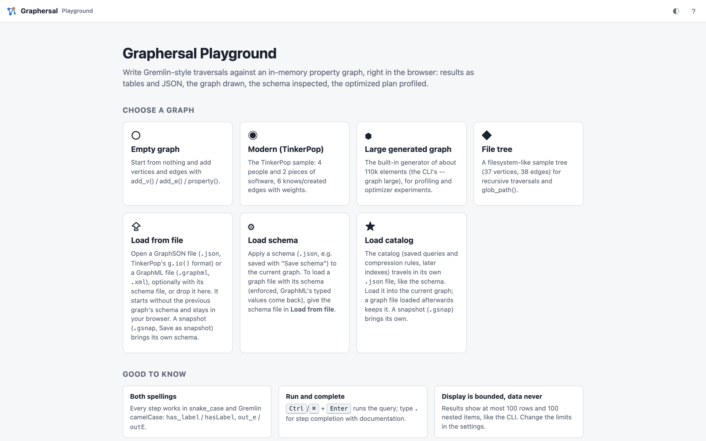
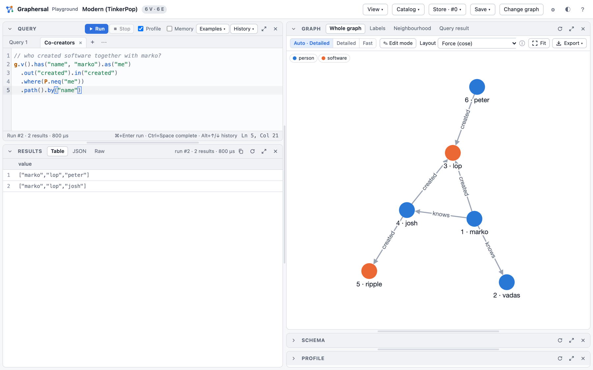
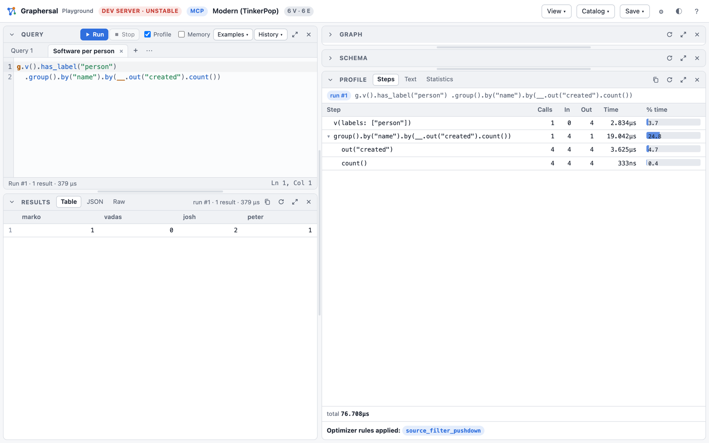
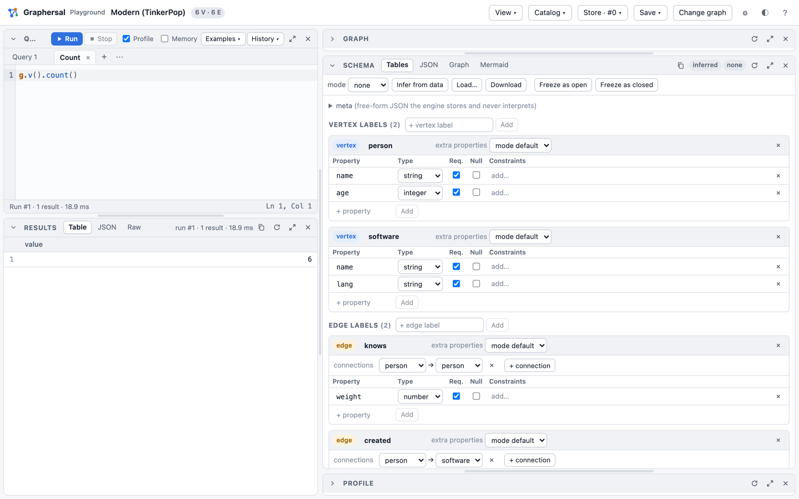

# Try It in the Browser

The playground is the quickest way to see what Graphersal does. It is a web page that runs the
real engine, compiled to WebAssembly, inside your browser: no server, no account, and your data
never leaves the machine.

## Start it

```bash
rustup target add wasm32-unknown-unknown                      # one-time
cargo install --locked wasm-bindgen-cli --version 0.2.129     # one-time
playground/build.sh                                           # builds playground/pkg/
python3 playground/serve.py 8000                              # open http://localhost:8000/
```

The start page offers sample graphs, or a GraphSON or GraphML file of your own:



Pick **Modern (TinkerPop)**: four people, two pieces of software, and who knows and created what.
Most examples in this book run on it.

## Run a query

Type a traversal into the Query panel and press `Ctrl`/`⌘`+`Enter`. The results appear as a table
(also as JSON and as the raw text the command line prints), and the Graph panel draws the graph.
Typing `.` offers every step with its description and a runnable example.



A few queries to start with; **Run in the playground** under each one opens it there:

```rhai,graph=modern
g.v().has_label("person").values("name")                       // all people
```

```rhai,graph=modern
g.v().has("name", "marko").out("knows").values("name")         // whom marko knows
```

```rhai,graph=modern
g.v().has_label("person").has("age", P.gt(30)).values("name")  // people older than 30
```

```rhai,graph=modern
g.v().has_label("person").group().by("name").by(__.out("created").count())   // software per person
```

The **Examples** menu holds about thirty more, grouped by graph and topic.

## See how it ran

With **Profile** on, every run also shows the plan the optimizer made of your query: each step
with its calls, traversers in and out and its time, plus the optimizer rules that changed the plan.
Here `has_label("person")` was folded into the start step (`v(labels: ["person"])`):



## Look at the schema

The Schema panel infers the structure of the data: the labels, their properties and types, and
which edges connect which labels. You can edit it, and **Freeze as open** or **Freeze as closed**
turns it into a schema the engine enforces on every write.



## Walk a bigger graph

The **File tree** sample is a small directory tree: good for recursive traversals with `repeat()`.


## What else is in there

- several query tabs side by side, a history and saved scripts;
- a graph editor (add, change and delete vertices and edges by clicking);
- a fast WebGL drawing for large graphs, label graphs and neighbourhood views;
- saved queries and compression rules in the **Catalog** menu;
- a Store in memory with commits, marks, point-in-time views, forks and rollback (the **Store**
  menu);
- downloads of the graph (GraphSON, GraphML, snapshot), the schema and the catalog.
- the green **Share link** button in the top bar: a link that opens your query together with a small graph,
  for example in a bug report ([Share a query with its graph](../users_guide/web_playground.md#share-a-query-with-its-graph)).

Every feature is described in [Web Playground](../users_guide/web_playground.md). The same UI also
runs against a graph on your disk, served by the command line tool:
[Dev Server, MCP and AI Chat](server_mcp_ai.md).
