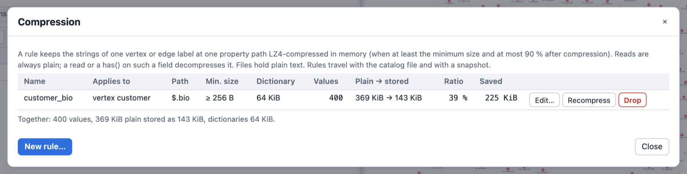

# Compressed Properties

Large text values that queries rarely read (a CV, a product description, a document body) can take
most of a graph's memory. A **compression rule** names where such values live (an element kind, a
label and a property path) and the graph keeps the strings there **LZ4-compressed in memory**. A
traversal that reads one gets the **plain** string, decompressed on the fly; the graph never holds a
decompressed copy. Nothing else changes: queries, results, change sets, exports and files see plain
strings only.

```rhai
// Strings of `customer` vertices at `details.career.cv` (and their `bio`) are kept compressed.
g.define_compression(#{name: "customer_cv", label: "customer", path: "details.career.cv"});
g.define_compression(#{name: "customer_bio", label: "customer", path: "bio", min_bytes: 512});
// An edge rule.
g.define_compression(#{name: "order_notes", element: "edge", label: "bought", path: "notes"});

g.v().has_label("customer").values(jpath("details.career.cv")).limit(1)   // plain text
g.compressions()                                                         // the rules and their stats
g.memory_usage()                                                         // compressed_values, ...
```

## When it pays off

- Long strings (hundreds of bytes and more) that are written once and read seldom: CVs,
  descriptions, notes, logs, document bodies. Typical text compresses to 40 to 55 % of its size
  (measured below); highly repetitive text much further.
- Not for short strings (names, codes): a value is compressed only when it is at least `min_bytes`
  long (default 256) **and** its compressed form is at most 90 % of the plain size; everything else
  stays plain.

## The cost model

- **A read decompresses.** `values()`, `value_map()`, `element_map()`, `project().by()`,
  `order().by()`, a jpath read, a result: each decompresses the value it reads (about 1.5 to 3 GB/s,
  below). A read that never touches the field costs nothing.
- **A filter on such a field decompresses every candidate.** `has("bio", TextP.containing("Rust"))`
  reads the text of every vertex it tests. Filter on other properties first. A
  [property index](property_indexes.md) on the field serves equality and ranges without reading
  the candidates, but it holds the plain text (the memory compression saved).
- **A write compresses** a string at a rule path (with the rule's dictionary). Only the touched
  top-level property is looked at; with no rule for the element's labels a write costs one lookup.
- **The disk stays plain.** Snapshots, the write-ahead log, GraphSON and GraphML hold the plain
  text: the persistence layer compresses whole chunks and large WAL records already, compressing
  single values twice would only cost CPU. A load compresses the rule paths again in one pass.

## Rules

A rule is a definition of kind `compression` in the graph's catalog, next to the saved queries. It
has:

| Field | Meaning | Default |
|---|---|---|
| `name` | an identifier, unique among the rules | required |
| `element` | `"vertex"` or `"edge"` | `"vertex"` |
| `label` | the label the rule applies to (it need not exist yet) | required |
| `path` | a property name or a jpath of names: `"cv"`, `"details.career.cv"`, `jpath("$['a b'].c")`; no index (`[0]`, `[-1]`): arrays are not compressed in this version | required |
| `codec` | `"lz4"` (the only codec of this version) | `"lz4"` |
| `min_bytes` | strings shorter than this (UTF-8 bytes) stay plain; 1 to 16 MiB | 256 |
| `dictionary` | build a dictionary from the rule's values | `true` |

- **Any number of rules**: several paths on one label, the same path on different labels, vertex
  and edge labels. One rule per element kind, label and path: a second one is refused
  (`DefinitionError::Conflict`, its help names `drop_compression`).
- **Several labels of one vertex**: every label's rules apply; when two labels have a rule for
  the same path, the first label in label order wins (the same rule as schema coercion).
- A **label change** (`add_vertex_label`/`remove_vertex_label`, `set_edge_label`) compresses what a new label's rules
  cover and decompresses what no rule covers any more.
- Only **strings** are compressed. A number, an object or an array at a rule path stays as it is.

### The explicit pass

Defining a rule, redefining it with other parameters, dropping it and loading the catalog run the
**pass** over the rule's label in the same commit: every value at the old and the new path is
re-encoded (compressed when it qualifies, decompressed when it no longer does). `g.recompress(name)`
runs it again on demand and rebuilds the dictionary, for example after much data was added to a
rule that was defined on an empty label. The pass changes no data: a commit hook sees only the
`SetDefinition` of the rule, and a `recompress` alone commits nothing.

### Dictionaries

With `dictionary: true` the pass builds a dictionary from a sample of the rule's current values (in
id order, up to 1 KiB of each value, up to 64 KiB, the LZ4 window) and compresses with it, which
helps short and similar texts most. A dictionary is in memory only: a load builds it again. A value
written before a dictionary exists (a rule on an empty label) is compressed without one until the
next `recompress` or load. Every compressed value carries its dictionary, so it stays readable when
the rule changes.

## API

| | Define | List | Drop | Recompress |
|---|---|---|---|---|
| Rhai (both spellings) | `g.define_compression(#{..})` | `g.compressions()` | `g.drop_compression(name)` | `g.recompress(name)` |
| Rust (`GraphTraversalSource`) | `define_compression(name, CompressionDefinition)`, `set_definition(Definition::compression(..))` | `list_definitions(Some(DefinitionKind::COMPRESSION))`, `compression_stats(name)` | `remove_definition(DefinitionKind::COMPRESSION, name)` | `recompress(name)` |
| Python (`Graph`) | `define_compression(name, label, path, element="vertex", min_bytes=256, dictionary=True)` | `compressions()` | `drop_compression(name)` | `recompress(name)` |
| Playground | **Catalog ▾ ▸ Compression**: the rules with their stats, a form with field errors | | | |
| Dev server | `POST /api/compression/define` | `GET /api/compression` | `POST /api/compression/drop` | `POST /api/compression/recompress` |
| MCP | `define_compression` | `list_compressions` | `drop_compression` | `recompress` |

`g.compressions()` lists each rule with `compressed_values`, `plain_bytes`, `stored_bytes` and
`dictionary_bytes`. `g.memory_usage()` (and `MemoryStats`) adds `compressed_values`,
`compressed_plain_bytes`, `compressed_stored_bytes` and `compression_dictionary_bytes`;
`property_bytes` counts the compressed (stored) size.

```rust
use graphersal::prelude::*;
use graphersal::{catalog::CompressionDefinition, storage::ElementKind};

let mut graph = TraversalGraph::new();
let rule = CompressionDefinition::new(ElementKind::Vertex, "customer", "details.career.cv")
    .unwrap()
    .with_min_bytes(512)
    .with_dictionary(false);
graph.traversal_mut().define_compression("customer_cv", rule).unwrap();
```

**Authorization**: a rule is the resource `Definition { kind: compression, name }`: define asks
`Create` (`Update` when it replaces one), drop `Delete`, recompress `Update`, listing `Read`. No data
request is made (the logical data does not change). `AccessPolicy::read_only()`, the MCP read-only
mode and a saved query (which always runs read-only) cannot change rules.

**The catalog file**: rules travel with the saved queries in one catalog file
(`{"definitions": [..]}`, the playground's **Catalog ▾ ▸ Save catalog**, the dev server's
`GET /api/catalog/export`); loading it stores the rules and compresses their values at once. A
snapshot and a Store carry the catalog, so a rule survives every store operation (WAL replay,
checkpoint, fork, backup, restore, repair, rollback); the files hold plain values, and the load
compresses again. A version that does not know the kind keeps the rule unchanged and only loses the
compression (the definition is not critical).

In the playground, **Catalog ▾ ▸ Compression** lists the rules with their statistics (here 400
customer biographies, about 1 KiB each) and defines, edits, recompresses and drops them:



## Measured

On a generated CV-like corpus of 5,000 texts of 2 to 20 KB (55 MB: section headers, sentences
from a 200-word vocabulary, company names, years and numbers), Apple M-series, `--release`
(`compressed_property_tests::measure_ratio_and_throughput`, an `#[ignore]`d test):

| | Stored / plain | Dictionary | Define pass (compress) | Read (decompress + materialize) |
|---|---:|---:|---:|---:|
| LZ4 | 0.52 | none | 451 MB/s | 2,741 MB/s |
| LZ4 with dictionary | 0.42 | 64 KiB | 328 MB/s | 1,626 MB/s |

The compression figures include a round-trip check of every value (a compressed value is verified
once when it is made, so reading it back cannot fail). A highly repetitive corpus (a dozen phrases
recombined) compresses to 0.07 (0.05 with a dictionary).
The figures come from a source build, not from the musl-linked prebuilt Linux binary
([Performance of the prebuilt Linux binaries](../getting_started/installation.md#performance-of-the-prebuilt-linux-binaries)).
