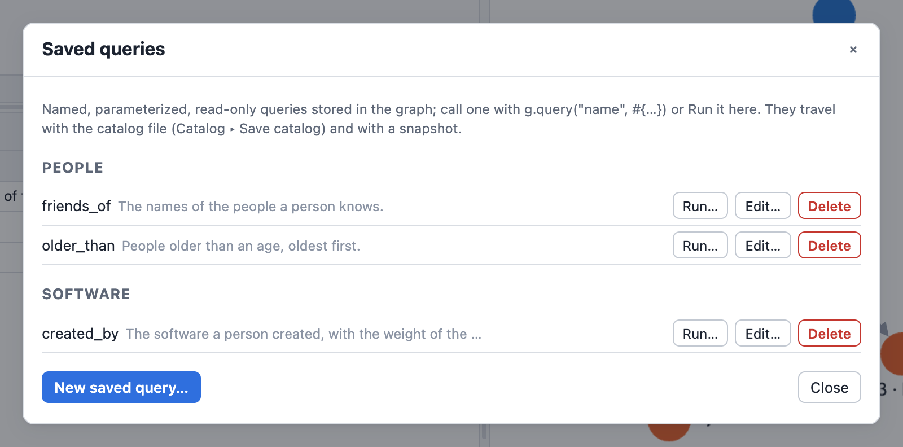
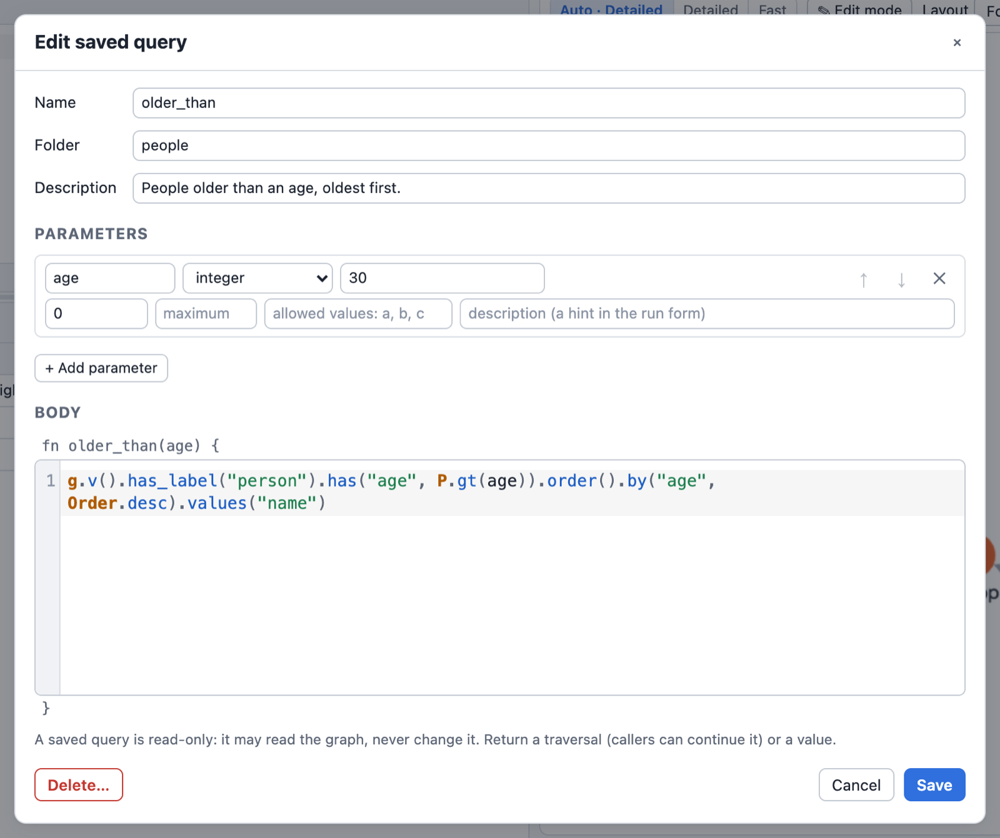
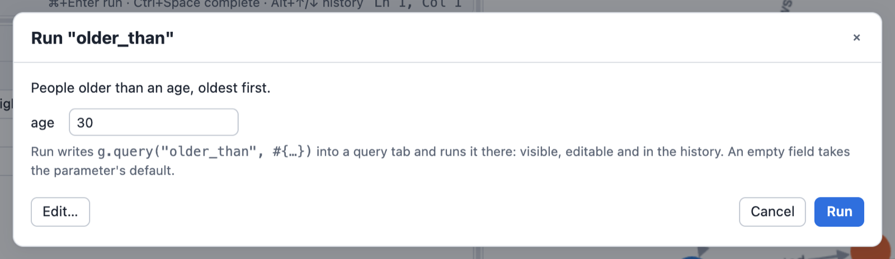

# Saved Queries

A *saved query* is a named, parameterized piece of DSL stored IN the database, next to the
schema: written once, called by name from any front end (the CLI, Python, the playground).

```
g.query("older_than", #{age: 30}).values("name").toList()
// ["josh", "peter"]
```

- The body is the text of ONE Rhai function; its parameters are named and typed.
- A call returns what the function returns: a **traversal** can be continued by the caller (like a
  SQL view), a **value** (a number, a list, a map) is a value (like a stored procedure).
- Saved queries are **read-only, always**: a query never writes data, the schema, the saved
  queries or files, not even through a query it calls or a traversal it returns.
- Queries live in **folders** (an attribute, not part of the name) and carry an optional
  **description**.

Every example on this page was run with `graphersal` on the default modern graph; the line after
`//` is its real output. Each block starts from a fresh graph.

## Defining a query

```
g.define_query(#{
    name: "older_than",
    folder: "reports/people",
    description: "Persons older than the given age.",
    params: #{
        age: #{schema: #{type: "integer", minimum: 0, maximum: 150,
                         description: "Age in years"},
               default: 30}
    },
    body: `fn older_than(age) {
        g.v().has_label("person").has("age", P.gt(age)).order().by("age")
    }`
})
g.query("older_than").values("name").toList()
// ["josh", "peter"]
```

`g.define_query(#{..})` (`g.defineQuery(..)`) stores a new query or replaces the one of that
name. The keys:

| Key | Required | Meaning |
|---|---|---|
| `name` | yes | the query's name, also its Rhai function name: `[A-Za-z_][A-Za-z0-9_]*`, 1 to 128 bytes, not a Rhai keyword; case-sensitive, unique per database |
| `body` | yes | the text of ONE Rhai function named like the query |
| `params` | when the function has parameters | parameter name -> its declaration (see [Parameters](#parameters)) |
| `folder` | no | a `/`-separated path such as `"reports/sales"`; `""` or `()` is the root |
| `description` | no | free text (at most 4 KiB); defaults to the function's doc comment |
| `meta` | no | free text, stored and never interpreted |

The definition is checked before anything is stored, and refused with an error naming the
problem:

- the body compiles and is exactly one function named like the query, with nothing beside it;
- every parameter of the function is declared in `params`, and `params` declares nothing else;
- the catalog rules: name, folder (at most 8 segments, 255 bytes), sizes (source at most 64 KiB),
  parameter names (not a DSL global such as `g`, `P` or `T`), every parameter schema, and every
  default against its schema.

Saved queries called by the body are not checked at definition: a missing one fails when it is
called.

### Several queries at once

`g.define_queries(folder, source[, params])` (`g.defineQueries(..)`) stores every function of a
source as a query of its own, named like the function, described by its doc comment (`///`
lines or a `/** .. */` block). `params` maps each function name to its parameter map. All of
them are stored in one unit: either every query is stored or none. It returns the names.

```
g.define_queries("reports/sales", `
    /// Persons, oldest first.
    fn oldest(n) { g.v().has_label("person").order().by("age", Order.desc).limit(n) }

    /// Software names.
    fn software() { g.v().has_label("software").values("name") }
`, #{oldest: #{n: #{schema: #{type: "integer", minimum: 1}, default: 2}}})
// ["oldest", "software"]
g.query("oldest").values("name").toList()
// ["peter", "josh"]
g.get_query("oldest")["body"]
// fn oldest(n) { g.v().has_label("person").order().by("age", Order.desc).limit(n) }
```

Each query stores the text of its own function only.

## Parameters

A parameter is declared as `#{schema: <schema node>, default: <value>}`, or as a bare type name
(the short form): `"integer"`, `"number"`, `"string"`, `"boolean"`, `"array"`, `"object"`,
`"null"` or `"uuid"`.

- The **schema** uses the node format of the [graph schema](schema_enforcement.md): `type`,
  `enum`, `minimum`, `maximum`, `pattern`, `minLength`, `items`, ..., and the annotations
  `title`, `description`, `examples`.
- The **default** sits beside the schema, not inside it: a `default` keyword inside the
  parameter's schema is an annotation (a data schema's `default` applies only when a vertex or
  edge is created), while a parameter default IS substituted when the argument is left out. A
  parameter without a default is required. A `defaultFunction` (`uuidv4`, `now`, ...) anywhere
  in a parameter's schema is an error: it fills a property of a created element and means
  nothing for an argument.

Arguments are **named**: `g.query("x", #{limit: 5})`, or `g.query("x")` when every parameter has
a default. An argument is a data value (a string, a number, a boolean, a UUID, a date or time, a
list, a map; never a traversal or a closure), bound to the function's parameter like a
prepared-statement parameter, never spliced into text. It is checked against its schema before
the body runs; the only conversion is the schema's write coercion (an `int64` where a `float64` is
declared, a canonical UUID string where a `uuid` is declared, the ISO 8601 text of a declared
[date or time format](../dates/schema.md) such as `date-time`). `()` is a value (null), not an omitted
argument.

```
g.query("older_than", #{age: 200})
// Error: Invalid argument 'age' for saved query 'older_than': Constraint violation on 'older_than.age': value <= 150 (actual: 200)
g.query("older_than", #{years: 30})
// Error: Saved query 'older_than' has no parameter 'years'
```

## Calling a query

`g.query(name)` / `g.query(name, #{..})` calls the query at the **start** of a traversal, on `g`;
it works anywhere a script can use `g` (loops, functions, the body of another saved query). It is
not a step: `g.v().query(..)` and `__.query(..)` fail with an error that says so (calling a query
on incoming traversers is a later feature).

A traversal result is continued like any other traversal, and the optimizer sees the whole plan:
the caller's filters are pushed into the body's steps.

```
g.define_query(#{name: "everything", body: "fn everything() { g.v() }"})
g.query("everything").has_label("person").count().profile()
// Step                                    Call      In     Out  ...
// v(labels: ["person"]).count()              1       0       4  ...
// Optimizer rules applied: source_filter_pushdown, count_pushdown
```

A value result is returned as it is:

```
g.define_query(#{name: "stats", body: `fn stats() {
    #{people: g.v().has_label("person").count().next(), software: g.v().has_label("software").count().next()}
}`})
g.query("stats")
// #{"people": 4, "software": 2}
```

A call does not recompile an unchanged body: a compiled body is cached per thread, keyed by
the stored text, so a redefined query (or one restored by a rollback) always runs its current
body, and the plan is made anew on every call (new optimizations apply to old queries).

Saved queries may call each other up to **16 levels** deep; a deeper call (usually a query that
calls itself without an end) fails with `Saved query calls nested deeper than 16 levels`.

## Read-only, always

A saved query never writes. The call runs under a read-only restriction on top of the host's
authorizer: creating, changing or deleting data, the schema, saved queries or files is denied
with `PermissionDenied` (`a saved query is read-only`) before anything runs, and nested queries
inherit it, so no chain of calls can write. A traversal the query returns carries the
restriction too:

```
g.define_query(#{name: "people", body: "fn people() { g.v().has_label(\"person\") }"})
g.query("people").property("seen", true).toList()
// Error: ... Permission denied for 'property' (Update Data): a saved query is read-only: ...
```

Write in a traversal of your own after the call:

```
let ids = g.query("people").id().toList();
g.v(ids).property("seen", true).toList();
g.v().has("seen").count().next()
// 4
```

- A query that returns a traversal with a writing step (`fn f() { g.v().drop() }`) fails at the
  call (`returned a traversal with a writing step`).
- A graph the query builds itself (`GraphSource::empty()`, `__`) stays writable; it is not the
  database.
- Terminals inside the body (`next()`, `toList()`) are allowed: a value-returning query needs
  them. Each runs as a reading traversal of its own.
- For the analysis of a host, nothing built from a query result is mutating
  (`is_mutating()` is false), so a read-only host can offer every saved query and the playground
  needs no confirmation before running one.

A writing kind of stored code ("procedure") may come later as a definition kind of its own.

## Errors name the query

An error inside a body keeps its diagnostic and gains one line per call, innermost first:

```
g.define_query(#{name: "broken", body: "fn broken() { g.v().values(\"name\").as_number(GType.LONG).toList() }"})
g.query("broken")
// Error: Step #2 'as_number(GType.LONG)' execution failed
//   at #2: v().values("name").as_number(GType.LONG)
// ...
// Caused by: Cast exception: expected type [int64], got type 'string'
//   value:  "marko"
//   origin: vertex id="1" label="person" property="name"
//   in saved query: "broken" (line 1, position 58 of its body)
// Help: ...
```

A missing query, a body that no longer compiles and a call at the wrong position fail with
errors naming the query and a `Help:` line with the fix.

## Managing queries

| Call | Result |
|---|---|
| `g.queries()` | every saved query as a list of maps, by name |
| `g.queries("reports")` | the queries in `reports` and the folders below it (`reports/sales`, not `reportsx`) |
| `g.get_query(name)` / `getQuery` | one query as a map, `()` when there is none |
| `g.drop_query(name)` / `dropQuery` | removes it; `false` when there was none |
| `g.move_query(name, folder)` / `moveQuery` | moves it (`""` or `()`: the root) |
| `g.describe_query(name, text)` / `describeQuery` | sets the description (`""` or `()` removes it) |

An entry of `queries()` has `name`, `folder` and `description` (`()` when absent), `params` (a
list in signature order: `#{name, schema, default?, required}`) and `status`: `"ok"`, or
`"error"` with `error`, the reason the body does not run (a body stored by an older version or
through the Rust API that does not compile). `get_query` adds `body`, `dialect` and `meta`.

```
g.define_query(#{name: "older_than", folder: "reports/people", params: #{age: #{schema: #{type: "integer"}, default: 30}},
                 body: "fn older_than(age) { g.v().has(\"age\", P.gt(age)) }"})
g.queries("reports")
// [#{"description": (), "folder": "reports/people", "name": "older_than", "params": [#{"default": 30, "name": "age", "required": false, "schema": #{"type": "integer"}}], "status": "ok"}]
```

Moving a query or renaming a folder never breaks a caller: a call uses the name only. Dropping a
query that others call is allowed (dependencies are not tracked); the callers fail when they call
it.

Every change of the catalog (define, replace, move, describe, drop) is a database change like a
schema change: one unit of its own, or a savepoint inside a running unit (the playground runs a
script as one unit, so a script that fails leaves no definition behind), rolled back with it,
visible to commit hooks as a `SetDefinition` mutation (see [Transactions](transactions.md)).

## Permissions

Calling a query asks `Execute` on `Definition(query "name")` before the body runs; the body's own
reads are then asked as usual. Listing asks `Read`, defining `Create` (`Update` to replace, move
or describe), dropping `Delete`. `AccessPolicy::read_only()` allows calling and listing. See
[Permissions](permissions.md).

## Limits

| What | Limit |
|---|---|
| name | 1 to 128 bytes, `[A-Za-z_][A-Za-z0-9_]*`, not a Rhai keyword |
| folder | at most 255 bytes and 8 segments |
| description | at most 4 KiB |
| body (source) | at most 64 KiB |
| parameters | at most 64 per query |
| definitions | at most 10 000 per database |
| call depth | 16 |

## Persistence

The catalog is part of the database: a [Store](../persistence/overview.md) keeps it in its
snapshots and journal, losslessly (every catalog change is a durable commit; recovery, rollback,
forks and backups carry it), and a packed snapshot (`.gsnap`) carries it too. A query is stored as
its source text, never as a compiled plan: every call plans anew. GraphML and GraphSON carry no
saved queries, like they carry no schema. The byte layout is in the
[format spec](../persistence/format.md) (sections 6.3, 9.3 and 16).

## Front ends

- **Playground** (WebAssembly and the dev server alike): the **Catalog ▾ ▸ Saved queries** manager
  lists the queries by folder, creates and edits them in an editor with a parameter list and the
  body in the code editor, deletes them, and runs one from a form built from its parameter
  schemas, which writes the `g.query(..)` call into a query tab. Saved queries travel in the catalog file with the other
  definitions (**Catalog ▾ ▸ Save catalog**, **Load catalog**), like the schema. See
  [Web Playground](web_playground.md#saved-queries).
- **MCP** (the [dev server](../persistence/dev_server.md#what-the-agent-gets) with `--mcp`): an AI
  agent lists them with `list_saved_queries`, runs one with `run_saved_query`, reads
  `graphersal://saved-queries`, and is told to look for a saved query before writing a new one;
  `--mcp-query-tools` also offers each query as a tool of its own. All of it works read-only.
- **Python**: `graph.queries(folder)`, `graph.get_query(name)`, `graph.define_query(spec)`,
  `graph.drop_query(name)` and `graph.call_query(name, params)` (`graph.query` stays the alias of
  `execute`).
- **CLI**: the DSL calls (`graphersal -e 'g.queries()'`); `graphersal store info <dir>` prints how
  many definitions a Store's catalog holds.

In the playground, **Catalog ▾ ▸ Saved queries** lists the queries by folder:



**Edit…** opens the editor: name, folder, description, every parameter with its type, default and
constraints, and the body in the code editor:



**Run…** builds a form from the parameter schemas; **Run** writes the `g.query(..)` call into a
query tab and runs it there:



## In Rust

The catalog is reachable without the DSL: `GraphTraversalSource::list_definitions`,
`get_definition`, `define_query(name, QueryDefinition)`, `remove_definition`, `move_query`,
`describe_query` (module `graphersal::catalog`). The Rust API stores a body without
compiling it (the core has no Rhai); the DSL compiles it on definition and on every call.

## Host-defined catalog kinds

Saved queries are one kind of catalog definition; [property indexes](property_indexes.md) and
compression rules are others. An application
built on the library (a server, say) can keep its own entities in the same catalog, so they are
stored, journaled, rolled back, forked and backed up with the graph: definition kinds 128 to 255
are reserved for hosts and never assigned by the library (`DefinitionKind::host(n)` refuses a
kind below 128; `DefinitionKind::HOST_FIRST`/`HOST_LAST`, `is_host()`). Kind 2 is the library's
property index.

```rust,ignore
use graphersal::catalog::{decode_payload, encode_payload};
use graphersal::catalog::{Definition, DefinitionFlags, DefinitionKind};

let kind = DefinitionKind::host(200).unwrap();
let bytes = encode_payload(&payload)?; // a property map, the codec of the library's own kinds
graph.set_definition(Definition::opaque(kind, DefinitionFlags::NONE, "person_name", bytes))?;
let back = decode_payload(graph.definition(kind, "person_name").unwrap().opaque_payload().unwrap())?;
```

The library keeps a host definition as opaque bytes: it checks only the name (1 to 1024 bytes)
and the payload size, writes the bytes back unchanged everywhere, and never reports them as
damage. `encode_payload`/`decode_payload` (feature `persist`) are optional, but they keep the
payload a property map like every library kind (decoding is safe on hostile input). The
*critical* flag means what it means for any kind the library does not decode: a store holding
a critical host definition opens read-only, and a Store refuses to write one. The byte rules are in the
[format spec](../persistence/format.md) (sections 6.3 and 16).
